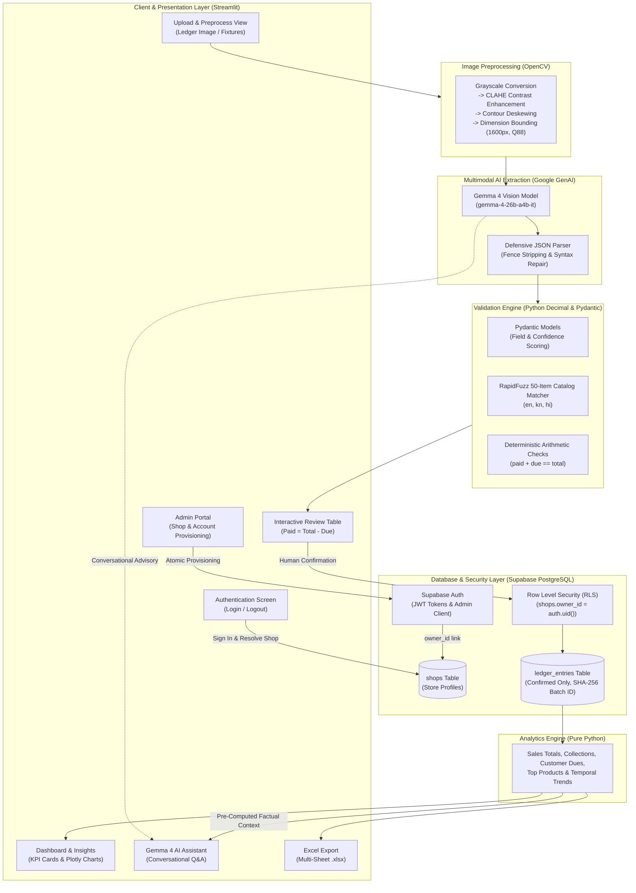

# Kirana Ledger Digitizer

> **AI-Powered Handwritten Ledger Digitization & Business Intelligence for Micro-Retailers**
> Developed by **TEAM TON UP** for **Hacktoberfest × VectorFlow 2026**
> **Track 1:** AI + Data Intelligence &nbsp;|&nbsp; **Challenge A:** Best Use of Gemma 4
> **Repository:** [`HackToBerFest-VVCE/t1c1-ton-up`](https://github.com/HackToBerFest-VVCE/t1c1-ton-up)

---

## 1. Project Overview

**Kirana Ledger Digitizer** is a production-oriented, privacy-first business assistant designed for India's ubiquitous neighborhood grocery stores (*kirana shops*). Local shopkeepers manage high-velocity daily trade using handwritten credit/debit notebooks (*khata books*). While flexible, manual paper bookkeeping creates severe operational bottlenecks: lost receivables, uncollected customer dues, time-consuming manual reconciliations, and total exclusion from digital analytics.

Kirana Ledger Digitizer bridges physical bookkeeping and digital intelligence:
1. **Captures and preprocesses** photographs of handwritten ledger pages using OpenCV (CLAHE contrast equalization, deskewing, and dimension bounding).
2. **Extracts structured transaction lines** using Google's **Gemma 4** (`gemma-4-26b-a4b-it`) vision model, preserving regional scripts (Kannada, Hindi, etc.) without lossy translation.
3. **Enforces human-in-the-loop review** through an interactive spreadsheet interface featuring one-click payment toggles (`✅ Fully Paid` / `❌ Has Due`) and automatic recalculation (`Paid = Total − Due`).
4. **Validates financial integrity deterministically** in pure Python using `Decimal` arithmetic (`Paid + Due == Total`), completely preventing AI arithmetic hallucination.
5. **Persists confirmed records** into Supabase PostgreSQL protected by Row Level Security (RLS) and SHA-256 batch idempotency.
6. **Delivers actionable business intelligence** through live KPI cards, interactive Plotly visualizations, multi-sheet Excel exports, and a conversational **Gemma 4 AI Business Assistant** grounded strictly in pre-computed financial facts.

---

## 2. Problem Statement

Across South Asia, tens of millions of micro-retailers rely on paper-based ledger notebooks. This informal system presents critical operational challenges:

- **Handwriting Complexity & Vernacular Diversity:** Ledger entries mix abbreviations, numerals, regional scripts (Kannada, Hindi, Telugu, Tamil), and colloquial terms. Generic optical character recognition (OCR) models fail on unconstrained handwriting and non-Latin scripts.
- **High-Friction Manual Data Entry:** Entering hundreds of micro-transactions into accounting software at the end of a 14-hour workday is impractical for sole proprietors.
- **Fragmented Credit & Outstanding Receivables:** Customer credit (*udhaar*) is scattered across dozens of notebook pages. Shopkeepers struggle to track cumulative customer debts, overdue balances, and cash collections (*jama/rokkha*).
- **Linguistic and Digital Barriers:** Conventional desktop enterprise software (e.g., Tally, Zoho) requires English fluency, formal bookkeeping literacy, and rigid data entry forms that alienate local merchants.

---

## 3. Our Solution

Kirana Ledger Digitizer combines multimodal AI with deterministic software engineering:

```
[Handwritten Ledger Photo]
            │
            ▼
┌─────────────────────────┐
│   OpenCV Preprocessing   │  CLAHE Contrast, Deskew, Safe Crop, Dimension Bounding
└───────────┬─────────────┘
            ▼
┌─────────────────────────┐
│    Gemma 4 Extraction   │  Multimodal Vision (gemma-4-26b-a4b-it) + Verbatim Script Retention
└───────────┬─────────────┘
            ▼
┌─────────────────────────┐
│   Structured Validation │  Defensive JSON Repair + Pydantic v2 + Decimal Math Check
└───────────┬─────────────┘
            ▼
┌─────────────────────────┐
│   Human-in-the-Loop     │  Streamlit Review Table: Interactive Paid/Due Synchronization
└───────────┬─────────────┘
            ▼
┌─────────────────────────┐
│  Supabase PostgreSQL    │  Confirmed-Only Storage + Row Level Security (Tenant Isolation)
└───────────┬─────────────┘
            ▼
┌─────────────────────────┐
│  Python Analytics Engine │  Deterministic Sales, Customer Dues, Top Products, Trends
└───────────┬─────────────┘
            ▼
┌───────────────────────────────────────────────────────────┐
│   Live Dashboard   │  Gemma 4 Business Assistant  │ Excel │
│  (Plotly Charts)   │    (Grounded Factual Q&A)    │ (.xlsx)│
└───────────────────────────────────────────────────────────┘
```

### Core Architecture Principles:
- **AI for Perception, Python for Arithmetic:** Gemma 4 reads handwritten scripts and transcribes customer/item names. All calculations—line totals, customer dues, sales summaries, and balance distributions—are computed deterministically in Python using the `Decimal` module.
- **Human-in-the-Loop Verification:** AI extraction is treated as a proposal. Extracted lines are flagged for human review whenever handwriting confidence is low, fields are missing, or dates are ambiguous.
- **Confirmed-Only Persistence:** Unverified raw OCR output is never saved to the database. Only rows explicitly reviewed and confirmed by the shopkeeper enter persistent storage.
- **Strict Multi-Tenant Isolation:** PostgreSQL Row Level Security (RLS) ensures that every shopkeeper account accesses only their store's transactions.

---

## 4. Key Features

### 📷 Vision Preprocessing & Gemma 4 Multimodal Extraction
- **OpenCV Enhancement Pipeline:** Automatically converts images to grayscale, applies Contrast Limited Adaptive Histogram Equalization (CLAHE) to separate ink from discolored or textured paper, deskews tilted notebook photos, crops borders, and bounds resolution to 1600px with 88% JPEG quality to optimize payload transmission and reduce Gemma API response latency.
- **Verbatim Regional Extraction:** Prompts Gemma 4 to preserve handwritten Kannada, Hindi, and colloquial terms exactly as written without forced English translation.
- **Defensive Parsing & Repair:** Multi-tier JSON parser strips markdown fences, repairs trailing commas, balances brackets, and fixes quotation anomalies common in generative outputs.
- **Canonical Product Catalog Matching:** Leverages `RapidFuzz` to match vernacular abbreviations against a canonical 50-item kirana product catalog (`data/items.csv`) across English, Kannada, and Hindi.

### ✍️ Interactive Transaction Review & Payment Recalculation
- **Interactive Payment Status Toggles:** Each transaction row provides two mutually exclusive options:
  - `✅ Fully Paid`: Automatically sets `Paid = Total` and `Due = 0`.
  - `❌ Has Due`: Enables an editable numeric input for **Due Amount (₹)** and instantly calculates `Paid = Total − Due`.
- **Independent Row Synchronization:** Row edits update the underlying DataFrame and UI state immediately without depending on adjacent row interactions.
- **Review Reason Flags:** Highlights uncertain fields (`LOW_CONFIDENCE`, `CANDIDATE_READINGS`, `MATH_MISMATCH`, `INFERRED_YEAR`, `MISSING_ITEM`).

### 🏪 Multi-Shop Architecture & Admin Portal
- **Single-User-per-Shop Model:** Every shop is linked directly to exactly one designated login account via `shops.owner_id = auth.users.id`.
- **Atomic Shop & Account Provisioning:** Administrators provision a new shop and its owner login account through a single consolidated form (`provision_shop_with_owner`).
- **Safe Retries & Rollback:**
  - Idempotent: Retrying an existing account and shop returns the existing record without duplicate insertion.
  - Conflict-Free: Prevents one user account from claiming multiple stores.
  - Orphan Cleanup: If user creation succeeds in Supabase Auth but shop insertion fails, the newly created auth user is immediately purged to maintain clean state.
- **Automatic Shop Resolution:** Upon login, the application automatically resolves the owner's shop without requiring manual shop selection dropdowns.
- **Registered Stores Directory:** Admin overview table displaying store names, owners, contact details, configured languages, confirmed transaction counts, active status, and creation dates.
- **Cascade-Protected Shop Management:** Allows editing store details and deleting empty stores safely. Shops with confirmed transactions require explicit cascade confirmation to prevent accidental loss of financial records.

### 📊 Real-Time Business Dashboard & Analytics
- **Live Financial KPIs:** Computes Total Sales, Total Collected Revenue, Outstanding Dues, Active Customers, and Transaction Counts.
- **Interactive Plotly Visualizations:**
  - Payment Distribution donut chart (Collected Cash vs. Outstanding Credit).
  - Top 5 Products horizontal bar chart by revenue and units sold.
- **Customer Dues Ledger:** Aggregates outstanding credit balances grouped by customer name to prioritize debt collection.
- **On-Demand Refresh:** A dedicated `🔄 Refresh Dashboard` button invalidates cached session state and queries fresh Supabase records immediately after a save.

### 🤖 Grounded Gemma 4 AI Business Assistant
- **Zero Arithmetic Hallucination:** The assistant prompt is supplied with pre-computed Python financial summaries (sales totals, top selling items, top debtors, collection ratios). Gemma 4 is never asked to calculate arithmetic totals.
- **Multilingual Conversational Advisory:** Answers natural-language business questions in English, Kannada, Hindi, Telugu, and Tamil.
- **Latency Telemetry & Suggested Questions:** Displays query latency metrics (`analytics_calc_time_ms`, `api_latency_ms`, `total_request_time_ms`) and provides quick-prompt buttons for common store queries.

### 📁 Multi-Sheet Excel Export
- Generates structured `.xlsx` workbooks using `pandas` and `openpyxl`:
  - **Sheet 1 (`Transactions`):** All confirmed ledger records with quantities, units, prices, paid amounts, dues, and batch IDs.
  - **Sheet 2 (`Customer Dues`):** Outstanding customer balances sorted by debt amount.
  - **Sheet 3 (`Product Performance`):** Total sales volume, transaction counts, and generated revenue per item.

### 🌐 Multilingual Localization
- Complete multilingual packs across 5 languages:
  - **Kannada (`kn`):** Verified native retail translations (default).
  - **English (`en`):** Verified full interface.
  - **Hindi (`hi`):** Verified full interface.
  - **Telugu (`te`):** Draft language pack with native review notice.
  - **Tamil (`ta`):** Draft language pack with native review notice.

---

## 5. Technology Stack

| Layer | Component | Version / Library | Purpose in Project |
|---|---|---|---|
| **Runtime & Language** | Python | `3.11+` | Primary programming language |
| **Web Framework** | Streamlit | `>=1.37.0, <2.0.0` | Reactive web interface, data editor, and multilingual UI |
| **Multimodal Foundation** | Google GenAI SDK | `google-genai >=0.1.1` | Communication with Google Gemma 4 vision model |
| **Model** | Gemma 4 | `gemma-4-26b-a4b-it` | Multimodal transcription and conversational advisory |
| **Computer Vision** | OpenCV | `opencv-python-headless >=4.10.0` | Grayscale conversion, CLAHE contrast enhancement, deskewing |
| **Image Processing** | Pillow (PIL) | `>=10.4.0, <12.0.0` | Image format conversion and Streamlit rendering |
| **Validation & Schemas** | Pydantic v2 | `pydantic >=2.8.0`, `pydantic-settings >=2.4.0` | Strict data validation, schema enforcement, and safe config loading |
| **Arithmetic Engine** | Python `decimal` | Built-in Standard Library | Fixed-point arithmetic (`paid + due == total`) without float errors |
| **Database & Auth** | Supabase Python | `supabase >=2.6.0, <3.0.0` | Supabase Auth (JWT), PostgreSQL client, and Admin API |
| **Relational Database** | PostgreSQL | `15+` (Supabase Cloud) | Persistent storage with RLS policies, indexes, and triggers |
| **Data Analytics** | Pandas | `>=2.2.0, <3.0.0` | Aggregation, grouping, time-series, and customer credit analysis |
| **Fuzzy Matching** | RapidFuzz | `>=3.9.0, <4.0.0` | Levenshtein-based matching of vernacular abbreviations to catalog |
| **Data Visualization** | Plotly | `>=5.24.0, <6.0.0` | Interactive charts (payment donut chart, top products bar chart) |
| **Workbook Export** | openpyxl | `>=3.1.5, <4.0.0` | Multi-sheet Excel workbook export generation |
| **Testing** | unittest & pytest | `pytest >=8.3.0`, `pytest-mock >=3.14.0` | Automated test suite (199 tests, 100% pass rate) |

---

## 6. System Architecture



---

## 7. Workflow & User Journey

1. **Store Provisioning (Admin):** The platform administrator opens the **Admin Portal** and submits the **Create Shop & User Account** form. This registers the store in `public.shops` and provisions the credentials in `auth.users` in a single atomic transaction.
2. **Owner Authentication:** The shopkeeper logs in using their registered email and password. [`resolve_owner_shop`](file:///c:/Users/msche/Desktop/Ton Up/core/db.py#L111-L167) verifies their authenticated user UUID against `shops.owner_id` and automatically selects their shop.
3. **Ledger Capture & Preprocessing:** The shopkeeper uploads a photo of their handwritten notebook page (or selects an included test fixture). OpenCV executes CLAHE contrast enhancement, deskews the page, and resizes the image to 1600px.
4. **Gemma 4 Vision Extraction:** The preprocessed image is transmitted to Gemma 4 with instructions to preserve verbatim handwriting without translating names.
5. **Defensive Parsing & Validation:** The raw response is parsed, repaired, and validated. Uncertain items, missing values, date anomalies, and mathematical discrepancies are flagged for review.
6. **Interactive Review & Payment Calculation:** In the review table, the shopkeeper inspects flagged rows. Clicking `✅ Fully Paid` sets dues to zero and marks the amount collected. Clicking `❌ Has Due` allows typing the exact due amount, automatically calculating the collected portion.
7. **Confirmed Persistence:** The shopkeeper clicks **Confirm & Save to Supabase**. A deterministic SHA-256 hash of the batch prevents duplicate saves, and confirmed rows are stored in Supabase PostgreSQL under tenant RLS.
8. **Dashboard & Analytics:** The shopkeeper opens **Dashboard & Insights** to inspect real-time sales KPIs, collection percentages, and Plotly charts. Clicking `🔄 Refresh Dashboard` forces a fresh query to display newly confirmed records immediately.
9. **Conversational Advisory:** The shopkeeper queries the **Gemma 4 AI Business Assistant** in their preferred language. The assistant responds using pre-computed financial facts with zero calculation hallucination.
10. **Excel Export:** The shopkeeper clicks **Export Ledger to Excel** to download an organized multi-sheet `.xlsx` workbook for local bookkeeping or tax filing.

---

## 8. Installation & Setup

### Prerequisites
- **Operating System:** Windows 10/11 (or Linux / macOS)
- **Python:** Python 3.11.x (recommended)
- **Accounts & Keys:**
  - Google AI Studio API key (for Gemma 4)
  - Supabase Project URL, anon public key, and service-role key

### Step 1: Clone the Repository
```powershell
git clone https://github.com/HackToBerFest-VVCE/t1c1-ton-up.git
cd "t1c1-ton-up"
```

### Step 2: Create and Activate a Virtual Environment
```powershell
python -m venv .venv
.\.venv\Scripts\Activate.ps1
```

### Step 3: Install Required Dependencies
```powershell
python -m pip install --upgrade pip
pip install -r requirements.txt
```

### Step 4: Configure Environment Variables
Copy the template configuration file:
```powershell
Copy-Item .env.example .env
```
Open `.env` in your text editor and supply your credentials:
```ini
APP_ENV=development
DEBUG=true
DEFAULT_LANGUAGE=kn

# Google GenAI / Gemma 4
GEMMA_API_KEY=your_actual_google_ai_studio_key
GEMMA_MODEL=gemma-4-26b-a4b-it

# Supabase PostgreSQL
SUPABASE_URL=https://your-project-id.supabase.co
SUPABASE_KEY=your_supabase_anon_public_key
SUPABASE_SERVICE_ROLE_KEY=your_supabase_service_role_secret_key
```

### Step 5: Initialize the Supabase Database Schema
1. Open your [Supabase Dashboard](https://supabase.com/dashboard) and navigate to the **SQL Editor**.
2. Run [`sql/schema.sql`](file:///c:/Users/msche/Desktop/Ton Up/sql/schema.sql) to create tables, indexes, constraints, and Row Level Security policies.
3. If upgrading an existing database, run [`sql/migrations/001_add_paid_due_and_idempotency.sql`](file:///c:/Users/msche/Desktop/Ton Up/sql/migrations/001_add_paid_due_and_idempotency.sql) and [`sql/migrations/002_add_auth_and_rls.sql`](file:///c:/Users/msche/Desktop/Ton Up/sql/migrations/002_add_auth_and_rls.sql).

### Step 6: Run the Test Suite
Verify that all unit tests pass:
```powershell
python -m unittest discover tests -v
```

### Step 7: Launch the Application
```powershell
streamlit run app.py
```
Open your browser to `http://localhost:8501`.

---

## 9. Environment Configuration

All settings are managed via [`core/config.py`](file:///c:/Users/msche/Desktop/Ton Up/core/config.py) and loaded using Pydantic v2 conventions.

| Environment Variable | Required | Default Value | Description |
|---|---|---|---|
| `APP_ENV` | No | `development` | Environment mode (`development`, `testing`, `production`) |
| `DEBUG` | No | `false` | Enables verbose logging and diagnostic indicators |
| `DEFAULT_LANGUAGE` | No | `kn` | Initial UI language (`kn`, `en`, `hi`, `te`, `ta`) |
| `GEMMA_API_KEY` | **Yes\*** | `""` | Google AI Studio API key (\*optional if testing via offline fixtures) |
| `GEMMA_MODEL` | No | `gemma-4-26b-a4b-it` | Target Gemma model ID |
| `SUPABASE_URL` | **Yes\*** | `""` | Supabase project URL (`https://<id>.supabase.co`) |
| `SUPABASE_KEY` | **Yes\*** | `""` | Supabase anonymous public client key |
| `SUPABASE_SERVICE_ROLE_KEY` | **Yes\*** | `""` | **Server-side only** administrative key for user & shop provisioning |
| `SHOP_ID` | No | `None` | Optional pre-selected shop UUID |
| `ADMIN_EMAIL` | No | `""` | Optional platform administrator email |
| `CATALOG_MATCH_THRESHOLD` | No | `75.0` | RapidFuzz similarity threshold (0.0 to 100.0) |
| `UPLOAD_DIR` | No | `data/uploads` | Directory for uploaded ledger images |
| `MAX_UPLOAD_SIZE_MB` | No | `15` | Maximum upload file size in megabytes |
| `MAX_IMAGE_DIMENSION` | No | `1600` | Max width/height pixel dimension for OpenCV resizing |
| `IMAGE_QUALITY` | No | `88` | JPEG compression quality for payload transmission |
| `GEMMA_TIMEOUT_SECONDS` | No | `35` | Timeout in seconds for Gemma API calls |

> [!CAUTION]
> **Security Notice**: `SUPABASE_SERVICE_ROLE_KEY` has full administrative access and bypasses RLS. It must **never** be exposed in client code, committed to version control, or rendered in user-facing UI. The application uses `mask_secret()` to sanitize all keys in diagnostics and logs.

---

## 10. Database Schema & Security

The persistent data layer is implemented in Supabase PostgreSQL:

```
┌──────────────────┐           ┌──────────────────┐
│    auth.users    │           │      shops       │
├──────────────────┤ 1       1 ├──────────────────┤
│ id (UUID, PK)    │───────────│ id (UUID, PK)    │
│ email            │           │ owner_id (UUID)  │
└──────────────────┘           │ name, phone, ... │
                               └─────────┬────────┘
                                         │ 1
                                         │
                                         │ N
                               ┌─────────┴────────┐
                               │  ledger_entries  │
                               ├──────────────────┤
                               │ id (UUID, PK)    │
                               │ shop_id (UUID)   │
                               │ customer_name    │
                               │ item_name        │
                               │ total_amount     │
                               │ paid_amount      │
                               │ due_amount       │
                               │ batch_id         │
                               │ status           │
                               └──────────────────┘
```

### Relational Tables
- **`shops`**: Stores kirana store profiles, owner contact details, default languages, and the foreign key `owner_id REFERENCES auth.users(id)`.
- **`ledger_entries`**: Stores transaction lines with monetary amounts (`total_amount`, `paid_amount`, `due_amount`), standardized catalog items, customer names, dates, and SHA-256 batch IDs. Enforces `status IN ('pending', 'confirmed', 'rejected')`.
- **`item_aliases`**: Maps vernacular handwritten spellings to canonical catalog items (both shop-specific and global).
- **`corrections`**: Audit log recording human edits to AI-extracted values.
- **`reports`**: Cached JSON business metrics and multilingual summaries.

### Row Level Security (RLS) Policies
PostgreSQL enforces tenant isolation at the engine level:
```sql
-- Scopes ledger entries strictly to the authenticated store owner or platform admin
CREATE POLICY "ledger_entries_owner_select" ON ledger_entries
    FOR SELECT TO authenticated
    USING (
        EXISTS (
            SELECT 1 FROM shops
            WHERE shops.id = ledger_entries.shop_id
              AND (shops.owner_id = auth.uid() OR ((auth.jwt() -> 'app_metadata' ->> 'role') = 'admin'))
        )
    );
```
Shopkeepers can neither view nor mutate transaction data belonging to other shops.

### Batch Idempotency & Deduplication
To prevent accidental duplicate submissions when clicking save repeatedly, the schema enforces a unique composite constraint:
```sql
CREATE UNIQUE INDEX idx_ledger_entries_shop_batch_row
ON ledger_entries(shop_id, batch_id, row_index)
WHERE batch_id IS NOT NULL;
```

---

## 11. AI Design & Reliability

### Multimodal Extraction Strategy
1. **Verbatim Preservation:** The model is instructed to output exact handwritten vernacular text without translating regional names into English.
2. **Defensive Parsing:** If the model outputs conversational preamble or imperfect JSON, the regex-based `clean_json_response` and `repair_and_parse_json` sanitize the payload before Pydantic parsing.
3. **Offline Demo Mode:** If no Gemma API key is configured or network calls fail, the extractor falls back to verified offline fixtures (`data/sample_extractions/kannada_ledger_sample.json`, `hindi_mixed_ledger_sample.json`), allowing full demonstration of the review, saving, analytics, and export workflows.

### Grounded Business Assistant Architecture
To completely eliminate LLM hallucination of financial figures:
1. Pure Python calculations compute total sales, cash collections, outstanding dues, top products, and top debtors.
2. These structured facts are injected directly into the Gemma 4 system prompt as ground-truth context.
3. The prompt explicitly restricts Gemma 4 to interpreting and presenting the provided numbers in natural language.
4. Response caching prevents repeated API roundtrips for identical queries in the same session.

---

## 12. Verification & Testing

The project includes an automated test suite verifying data validation, math rules, database operations, RLS security, and multilingual functionality.

### Running the Test Suite
```powershell
python -m unittest discover tests -v
```

### Verified Test Results (Latest Run)
```
Ran 199 tests in 7.761s

OK
```
**199 / 199 tests passed (100% pass rate).**

### Test Module Coverage:
| Test Module | Tests | Verified Scope |
|---|---|---|
| [`test_admin_portal.py`](file:///c:/Users/msche/Desktop/Ton Up/tests/test_admin_portal.py) | 20 | Multi-shop management, single-user-per-shop isolation, retry idempotency, safe deletion |
| [`test_analytics.py`](file:///c:/Users/msche/Desktop/Ton Up/tests/test_analytics.py) | 16 | Decimal sales summaries, customer dues balances, top products, AOV calculations |
| [`test_assistant.py`](file:///c:/Users/msche/Desktop/Ton Up/tests/test_assistant.py) | 9 | Grounded context builder, factual constraints, latency telemetry, response caching |
| [`test_auth_and_rls.py`](file:///c:/Users/msche/Desktop/Ton Up/tests/test_auth_and_rls.py) | 18 | Sign in, sign out, role routing, RLS 42501 diagnostics, owner shop resolution |
| [`test_catalog.py`](file:///c:/Users/msche/Desktop/Ton Up/tests/test_catalog.py) | 12 | 50 canonical items, RapidFuzz threshold matching, Kannada/Hindi alias lookup |
| [`test_config.py`](file:///c:/Users/msche/Desktop/Ton Up/tests/test_config.py) | 10 | Secret masking (`mask_secret`), environment fallback, Pydantic validation |
| [`test_dashboard_refresh.py`](file:///c:/Users/msche/Desktop/Ton Up/tests/test_dashboard_refresh.py) | 8 | Cache invalidation, live Supabase re-fetching, metric recalculation |
| [`test_db_persistence.py`](file:///c:/Users/msche/Desktop/Ton Up/tests/test_db_persistence.py) | 14 | Confirmed-only storage, batch idempotency, RLS error handling, client resolution |
| [`test_editor_payment.py`](file:///c:/Users/msche/Desktop/Ton Up/tests/test_editor_payment.py) | 12 | Row-level `Paid = Total - Due` recalculation, editor sync, multi-row edits |
| [`test_export.py`](file:///c:/Users/msche/Desktop/Ton Up/tests/test_export.py) | 8 | Multi-sheet Excel workbook generation, column formatting, customer dues sheet |
| [`test_extractor.py`](file:///c:/Users/msche/Desktop/Ton Up/tests/test_extractor.py) | 17 | Prompt structure, defensive JSON repair, fixture fallback, extraction timing |
| [`test_i18n.py`](file:///c:/Users/msche/Desktop/Ton Up/tests/test_i18n.py) | 15 | Multilingual JSON pack parsing (en, kn, hi, te, ta), fallback to English, review flags |
| [`test_image_preprocessor.py`](file:///c:/Users/msche/Desktop/Ton Up/tests/test_image_preprocessor.py) | 11 | CLAHE contrast enhancement, deskewing, safe cropping, dimension bounding (1600px) |
| [`test_revalidation.py`](file:///c:/Users/msche/Desktop/Ton Up/tests/test_revalidation.py) | 11 | Dynamic row addition, flag clearance on manual edit, date ambiguity resolution |
| [`test_schema.py`](file:///c:/Users/msche/Desktop/Ton Up/tests/test_schema.py) | 9 | PostgreSQL table definitions, primary keys, foreign keys, status constraints, indexes |
| [`test_validator.py`](file:///c:/Users/msche/Desktop/Ton Up/tests/test_validator.py) | 9 | Decimal-safe arithmetic checks, date sanity checks, candidate readings flags |

---

## 13. Project Structure

```text
Ton Up/
├── .env.example                                  # Environment template with required variables
├── .gitignore                                    # Git ignore rules for virtualenvs, secrets, caches
├── app.py                                        # Streamlit application UI, routing, and workflows
├── README.md                                     # Technical project documentation
├── requirements.txt                              # Python dependency specifications
│
├── core/                                         # Core business logic and foundation
│   ├── __init__.py
│   ├── analytics.py                              # Decimal financial calculations and business insights
│   ├── assistant.py                              # Gemma 4 business assistant and prompt grounding
│   ├── auth.py                                   # Supabase Auth, session handling, and admin user APIs
│   ├── catalog.py                                # RapidFuzz kirana product catalog manager
│   ├── config.py                                 # Pydantic v2 application settings and secret masking
│   ├── db.py                                     # Supabase database operations, RLS, and provisioning
│   ├── exporter.py                               # Multi-sheet Excel workbook generator (.xlsx)
│   ├── extractor.py                              # Gemma 4 multimodal extraction and defensive parser
│   ├── i18n.py                                   # Multilingual manager and variable interpolation
│   ├── image_preprocessor.py                     # OpenCV CLAHE, deskewing, and image bounding
│   ├── models.py                                 # Pydantic v2 domain schemas and data structures
│   └── validator.py                              # Decimal arithmetic rules and review reason flags
│
├── data/                                         # Data assets and test fixtures
│   ├── items.csv                                 # Canonical 50 kirana products (en, kn, hi)
│   ├── sample_images/                            # Sample ledger photograph for testing
│   │   └── sample_ledger.png
│   └── sample_extractions/                       # Verified offline extraction fixtures
│       ├── hindi_mixed_ledger_sample.json
│       └── kannada_ledger_sample.json
│
├── languages/                                    # Multilingual JSON translation packs
│   ├── en.json                                   # English (Verified)
│   ├── hi.json                                   # Hindi (Verified)
│   ├── kn.json                                   # Kannada (Verified)
│   ├── ta.json                                   # Tamil (Draft - Needs Native Review)
│   └── te.json                                   # Telugu (Draft - Needs Native Review)
│
├── sql/                                          # Database schemas and migrations
│   ├── schema.sql                                # Full PostgreSQL schema, indexes, and RLS policies
│   └── migrations/
│       ├── 001_add_paid_due_and_idempotency.sql  # Paid/due columns and batch uniqueness
│       └── 002_add_auth_and_rls.sql              # Owner IDs and Row Level Security policies
│
└── tests/                                        # Automated test suite (199 tests)
    ├── __init__.py
    ├── test_admin_portal.py
    ├── test_analytics.py
    ├── test_assistant.py
    ├── test_auth_and_rls.py
    ├── test_catalog.py
    ├── test_config.py
    ├── test_dashboard_refresh.py
    ├── test_db_persistence.py
    ├── test_editor_payment.py
    ├── test_export.py
    ├── test_extractor.py
    ├── test_i18n.py
    ├── test_image_preprocessor.py
    ├── test_revalidation.py
    ├── test_schema.py
    └── test_validator.py
```

---

## 14. Limitations & Future Roadmap

### Current Limitations
- **Severely Degraded Paper:** Torn pages, overlapping handwriting, or heavy ink bleed may require the shopkeeper to manually edit or insert rows in the review table.
- **Draft Language Packs:** While Kannada, Hindi, and English are verified, Telugu and Tamil packs are machine-translated drafts flagged for native-speaker verification.
- **Single Login Account per Store:** The application currently enforces a strict 1:1 account-to-shop relationship; multi-staff role management (e.g., owner vs. cashier permissions) is not yet supported.
- **Network Dependency for Live AI:** Live extraction and assistant chats require an active internet connection to communicate with the Gemma API and Supabase (though local Demo Mode supports offline testing).

### Future Roadmap
- **Edge Inference:** Explore lightweight on-device Gemma models for zero-connectivity offline extraction on low-power devices.
- **Voice-Assisted Corrections:** Speech-to-text in Kannada and Hindi to allow hands-free ledger corrections during busy store hours.
- **Automated Customer WhatsApp Reminders:** Optional one-click generation of localized payment reminder messages for customers with overdue credit balances.
- **Thermal Receipt Printer Integration:** Direct printing of customer dues and settlement receipts via ESC/POS Bluetooth printers.

---

## 15. Team & Acknowledgements

Developed with passion by **TEAM TON UP**:
- **Project Repository:** [`HackToBerFest-VVCE/t1c1-ton-up`](https://github.com/HackToBerFest-VVCE/t1c1-ton-up)
- **Event:** Hacktoberfest × VectorFlow 2026
- **Track:** Track 1 — AI + Data Intelligence
- **Challenge:** Challenge A — Best Use of Gemma 4

### Acknowledgements
- **Google DeepMind & Google AI Studio** for access to the **Gemma 4** multimodal model architecture.
- **Supabase** for providing managed PostgreSQL, authentication, and Row Level Security infrastructure.
- **Streamlit** for the rapid, interactive data application framework.
